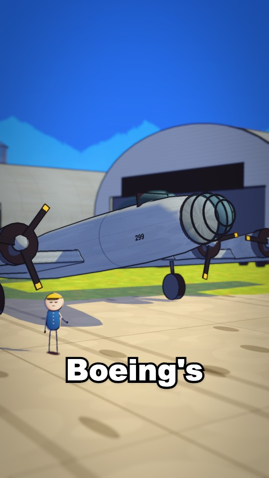

# Airfield, 1935

Wright Field, Ohio, on a clear autumn day: a pale concrete runway on painted autumn grass, a curved-roof hangar, the
officers' stand with bunting, 1930s cars, a fire truck and an ambulance, oil drums, a wind sock and a flag, birds,
wheel dust, and the wreck with fire and smoke. Also the hangar inside, the cockpit, and a sky place above the clouds.
The B-17 proof test's version A, the one Vincent picked.

## Good for

Early aviation; a farm field or any open field with buildings; the sky place for any flight above the clouds.

## Files

| File | What |
|---|---|
| `code/places/airfield.ts` | The airfield place (the blend: far picture, code middle and ground, detail layer, the plane posed each frame) |
| `code/places/hangar.ts`, `cockpit.ts`, `sky.ts` | The hangar inside, the cockpit, the sky above the clouds |
| `code/places/index.ts`, `light.ts`, `marks.ts` | The place list (`PlaceDef`), each place's light, and the marks (layout, far picture direction, crew) |
| `code/places/parts/blend.ts` | Far picture on curved screens, sky clouds, middle band, `fbm` noise |
| `code/props/sets.ts` | Hangar, stand, car, fire truck, ambulance, drums, wreck, scorch, crewman |
| `code/props/fx.ts` | Smoke column, flames, impact, wheel dust, wind sock, flag, flock of birds, cloud heap |
| `code/props/paint.ts` | Painted textures (grass, runway, metal, wood, corrugated) and material helpers |
| `pictures/airfield-far.jpg`, `sky-far.jpg` | The far band and the sky place's far picture |

## Copying it in

- It needs `vehicles/model-299` too: `airfield.ts`, `hangar.ts`, `sky.ts` and `sets.ts` import `../props/plane` and
  `../props/flight`. Copy both entries' `code/` into the same story folder.
- Imports of `../../../look/ink`, `shade` and `lights` expect the project's `src/look/`.
- `flight.ts` holds this story's flight on the film clock; write the new story's own.
- Rename `b17-checklist/pictures/` in the `pictures` fields to the new slug.

## Known faults

- `airfield-far.jpg` is the "before" example in `references/picture-rules.md`: flat midday, two thirds empty sky, one
  thin row of objects (S3-166, S3-167). Make a new far picture by the template before reusing the place.
- Midday light gives plain colours; relight it for golden hour or storm light with the new picture.
- Too little moves behind the hero (S3-169): add other planes on the apron or taxiing, ground crew at work, a car
  driving along the field edge.

## History

- 13 Nov 2026: copied from epiclings-b17-a (branch `proof/b17-a`), `src/stories/b17-checklist/places` and `props`.
