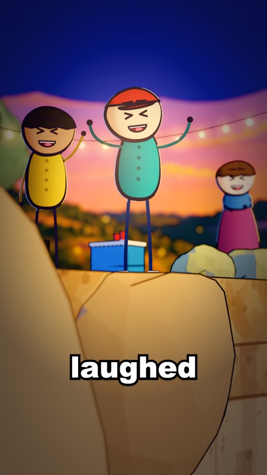

# Cliff and lake at golden hour

A limestone cliff in cream and ochre strata over a deep teal lake at dusk. Dry grass on top, rocks at the edge, string
lights, a cooler and a speaker for a party, and the lake's splash, rings, bubbles and a floating cap. The far picture
(`pictures/far.jpg`) is the one Vincent loved: golden hour, layered wooded hills and cliffs, big lit clouds, a lake with
reflections, a lit pavilion, birds. It is the "after" example in `references/picture-rules.md`.

## Good for

A lake, quarry, cliff or shore at sunset; a jump or a fall into water; a party outdoors at dusk.

## Files

| File | What |
|---|---|
| `code/world.ts` | The whole place: textures painted on canvases, the cliff, the lake, props, the splash. Loads `practice-cliff/far.jpg` with `staticFile` |
| `code/story.ts` | The spike's clock and marks, which `world.ts` imports (`TOP`, `SPLASH_AT`, `SPLASH_RISE`, `joshAt`, `CAP_OFF`, `FPS`) |
| `pictures/far.jpg` | The far band, 2688 x 1152 |

## Copying it in

- `world.ts` imports `./shade` (`twoTone`) and `./ink` (`NOINK`): point them at the project's `src/look/`.
- Replace the imports from `./story` with the new story's own clock and marks; keep `TOP` (the cliff top height, 5 m).
- Change `FAR_SRC` to `<slug>/pictures/far.jpg`.

## Known faults

- One file in the spike's old layout, with the story's clock inside it. The scene-layout version of the same place
  is `src/stories/cliff-josh/places/shore.ts` with `places/parts/blend.ts` and `splash.ts` on the bible-shorts branch
  `story/cliff-josh`: move to that layout when this entry is next improved.
- Textures are painted at 1024, below S3-8's 2048 near the camera.
- Party props are this story's; drop them for a quiet shore.

## History

- 13 Nov 2026: copied from bible-shorts `story/cliff-josh` (`src/stories/practice-cliff/`), spike 7's world.
