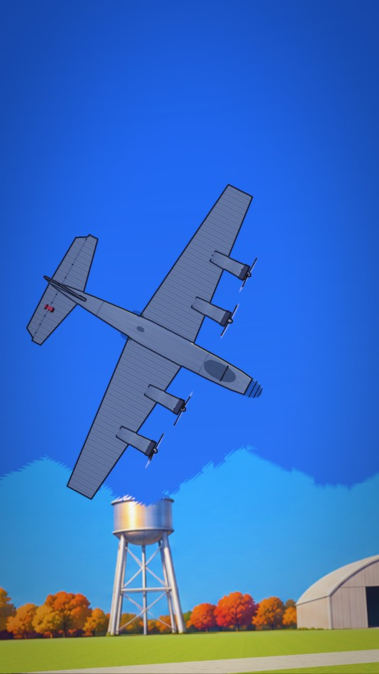

# Boeing Model 299

The B-17's prototype in code: polished aluminium on a lathe fuselage, a glass nose, four engines with three-blade
propellers that spin (a blurred disc at speed), a tall fin, elevators that can carry the red gust lock, landing gear.
Sized to the real plane (31.6 m span, 21 m long) against a 1.8 m person. The same build makes the Y1B-17s and the wreck.

## Good for

Any four-engine 1930s bomber or airliner; a takeoff, a stall and a crash; parked planes on an apron.

## Files

| File | What |
|---|---|
| `code/props/plane.ts` | `makePlane`: the model, pointing along +x, origin at the wing root |
| `code/props/flight.ts` | `PlanePose` and this story's flight on the film clock: tail-low takeoff, stall at about 90 m, wing down, the fall (1.9 s, held in frame) |

## Copying it in

- `plane.ts` imports `../../../look/ink` (`NOINK`) and `./paint` (from `places/airfield-1935/code/props/paint.ts`).
- `flight.ts` has no three.js imports, so scene tools load it in node. Keep `PlanePose`; rewrite the flight for the
  new story.

## Known faults

- From below at a steep angle it reads as a flat grey cross; light it warm from the side and add underside detail.
- Only one plane flies. Other planes behind the hero (S3-169) need more `makePlane` copies with their own paths.

## History

- 13 Nov 2026: copied from epiclings-b17-a (branch `proof/b17-a`), `src/stories/b17-checklist/props`.
